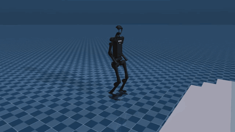
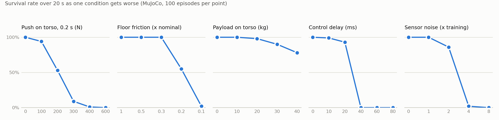
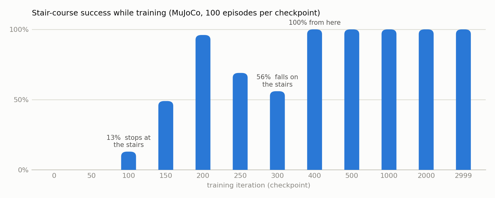
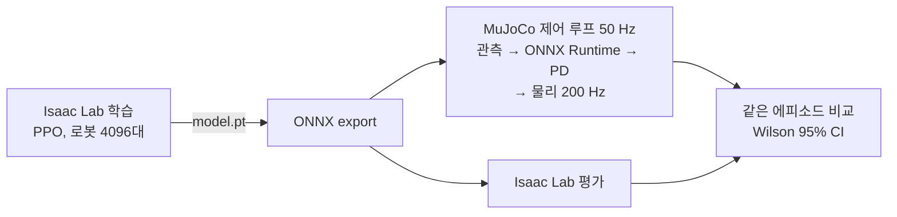

# HumanoidLocomotion

[](LICENSE)
[](#환경)


## 🌐 [English version → README_EN.md](README_EN.md)

Isaac Lab에서 PPO로 학습한 Unitree H1 보행 정책(평지·계단)을 ONNX로 내보내고,
학습에 쓰지 않은 물리엔진(MuJoCo)의 ONNX Runtime 제어 루프에서 같은 성능이 나오는지 검증했다.
가장 큰 약점인 제어 지연은 지연 무작위화 재학습으로 40 ms까지 버티게 만들었다.

| 학습 300 iteration: 계단을 오른 뒤 넘어짐 | 학습 3000 iteration: 계단 통과 |
|---|---|
|  |  |

**영상 (MuJoCo, 10초, 0.65 m/s):** [300 iteration](docs/media/stairs_it300.mp4) · [3000 iteration](docs/media/stairs_it2999.mp4) · 0·50·100 iteration과 평지 정책은 [docs/media](docs/media)

---

## 빠른 시작

학습된 정책을 MuJoCo 창에서 실행. GPU·Isaac Sim 불필요.

```powershell
python -m pip install mujoco==3.17.0 onnxruntime==1.23.2

# MuJoCo Menagerie에서 H1 모델만 받기
git clone --depth 1 --filter=blob:none --sparse https://github.com/google-deepmind/mujoco_menagerie.git ..\mujoco_menagerie
git -C ..\mujoco_menagerie sparse-checkout set unitree_h1
$env:MENAGERIE = "..\mujoco_menagerie"

python sim2sim.py policies\h1_stairs.onnx --course             # 계단 코스
python sim2sim.py policies\h1_flat.onnx --course               # 높이 입력 없는 평지 정책은 계단에서 넘어짐
python sim2sim.py policies\h1_flat.onnx --vx 0.8 --wz 0.5      # 평지, 속도 명령 지정 (m/s, rad/s)
```

로봇이 평지 1.5 m → 계단 3단 → 위쪽 평지까지 걷고, 끝에 닿거나 넘어지면 처음부터 다시 시작한다.

| 정책 | 입력 | 용도 |
|------|------|------|
| `policies/h1_flat.onnx` | 69 | 평지 보행 |
| `policies/h1_stairs.onnx` | 256 (69 + 바닥 높이 지도 187) | 계단·요철 보행 |
| `policies/h1_stairs_delay.onnx` | 256 | 계단, 제어 지연 0~40 ms 무작위화로 학습 |

ONNX 입력 `obs`, 출력 `actions` (batch 1). 입력 크기로 평지/계단 정책을 자동 구분한다.

---

## 개요

| 항목 | 내용 |
|------|------|
| 로봇 | Unitree H1 (관절 19개, 51.4 kg) |
| 작업 | 속도 명령(전진·회전) 추종 보행: 평지 / 계단 3단(높이 15 cm) + 평지 |
| 학습 | Isaac Lab PPO (rsl_rl), 로봇 4096대 GPU 병렬 |
| 정책 | MLP: 몸 상태 69 (+ 바닥 높이 지도 187) → 관절 목표 각도 19 |
| 배포 | ONNX Runtime(CPU) 50 Hz 제어 루프 + 관절 PD |
| 검증 엔진 | MuJoCo 3.17 + Menagerie `unitree_h1` (Isaac 모델과 따로 만든 모델) |
| 평가 | 두 엔진에서 같은 명령·시작 조건의 100 에피소드, Wilson 95% 신뢰구간 |

---

## 결과

### 두 엔진 비교 (같은 ONNX, 같은 100 에피소드)

| 시나리오 | Isaac Lab (학습 엔진) | MuJoCo (검증 엔진) |
|---|---|---|
| 평지 20초 보행, 넘어짐 | 0/100 | **0/100** (95% CI 0–3.7%) |
| 계단 3단 + 평지, 성공 | 100/100 | **100/100** (95% CI 96.3–100%) |
| 계단, 높이 지도 없는 평지 정책 | — | 0/100 |

- 계단 정책의 높이 지도 입력(ray 187개)을 MuJoCo에서 다시 구현, Isaac이 정책에 넣은 값과 같은 자세에서 비교: **차이 0.0000 m**
- 평지 속도 추종 오차: 선속도 0.063 vs 0.066 m/s로 같고, 회전만 0.054 vs 0.081 rad/s로 MuJoCo가 약 50% 큼 (관절 감쇠는 원인 아님 확인, 발 접촉·마찰 차이가 다음 후보)

### 제어 지연 대응 (계단 코스, MuJoCo, 각 100회 성공 수)

| 지연 | 0 ms | 10 ms | 20 ms | 30 ms | 40 ms | 60 ms |
|---|---|---|---|---|---|---|
| 기존 계단 정책 | 100 | 100 | 100 | 93 | 73 | 0 |
| **지연 무작위화 재학습** | 100 | 100 | 100 | **100** | **100** | **83** |

- 재학습: 학습 중 모터에 도착하는 관절 목표를 판마다 0~40 ms 무작위로 늦춤 ([h1_delay_cfg.py](h1_delay_cfg.py)). Isaac 계단 100/100 유지
- 대가: 지연 0 ms 도착 시간 6.70 → 6.95초
- PD 구현도 implicit → explicit으로 함께 바뀌어, 지연 학습만의 효과로 분리하지는 않음

### 평지 정책 강건성 한계 (MuJoCo, 조건 하나씩, 단계마다 100회)

<picture>
  <source media="(prefers-color-scheme: dark)" srcset="docs/images/robustness_dark.png">
  
</picture>

| 조건 | 20초 생존율 |
|---|---|
| 밀기 (몸통, 0.2초) | 100 N 94% → 200 N 53% → 300 N 9% |
| 바닥 마찰 | ×0.3까지 100% → ×0.2 55% → ×0.1 2% |
| 몸통 하중 | +20 kg 98% → +40 kg 78% |
| 제어 지연 | 10 ms 99% → 20 ms 93% → **40 ms 0%** |
| 센서 노이즈 (학습 수준 대비) | ×1 100% → ×2 86% → ×4 2% |

모든 조건에서 토크 포화 1.2% 이하 → 실패 원인은 모터 힘이 아니라 정책의 대응. 학습 때 센서 노이즈 외의 무작위화(밀기·마찰·질량·지연)가 꺼져 있었다.

### 학습 진행별 계단 성공률 (MuJoCo, checkpoint마다 100회)

<picture>
  <source media="(prefers-color-scheme: dark)" srcset="docs/images/stairs_by_checkpoint_dark.png">
  
</picture>

100 iteration은 계단 앞에서 멈추고, 250~300은 학습 지형 난이도가 오르는 구간과 겹쳐 계단 위에서 넘어지다가 400부터 100%.

---

## 아키텍처



MuJoCo 제어 루프는 실제 로봇 제어 루프와 같은 구조다 (시뮬레이터 상태 대신 센서 값을 넣으면 됨). 두 엔진에서 맞춘 항목:

| 항목 | 내용 | 검증 |
|---|---|---|
| 관절 순서 | Isaac은 너비 우선, MuJoCo는 다리→몸통→팔 → 이름으로 매핑 | [check_isaac_cfg.py](check_isaac_cfg.py)가 실제 env와 대조 |
| 관측 | 몸통 속도는 무게중심·몸통 좌표계, 회전 추종은 world z축 | 같은 스크립트 |
| 제어 | PD 게인, 기본 자세, action scale, dt/decimation | 같은 스크립트 |
| 높이 지도 | 몸통 위 20 m에서 수직 ray 17×11, heading만 따라감 | Isaac 기록값과 차이 0.0000 |
| ONNX | checkpoint → ONNX 변환 [export_ckpt.py](export_ckpt.py) | Isaac Lab exporter와 출력 차이 0.0 |

엔진 간 모델 차이는 그대로 둠: MuJoCo 모델은 토크 상한(발목 40 Nm, 팔 18~40 Nm)이 학습 설정(100~300 Nm)보다 좁고, 발 충돌 형상(capsule)과 관절 감쇠가 다르다.

---

## 학습

| | 평지 | 계단 | 계단 + 지연 |
|---|---|---|---|
| 작업 | `Isaac-Velocity-Flat-H1-v0` | `Isaac-Velocity-Rough-H1-v0` | 계단 + 모터 지연 0~40 ms |
| 입력 | 69 | 256 (+ 높이 지도 187) | 256 |
| actor MLP | 128-128-128 | 512-256-128 | 512-256-128 |
| 규모 | 4096대 × 24 step × 1000 iter | 4096대 × 24 step × 3000 iter | 같음 |
| 시간 (RTX 4070 SUPER) | 17분 | 1시간 2분 | 1시간 20분 |

- 입력 69 = 몸통 속도 3 + 회전 속도 3 + 중력 방향 3 + 속도 명령 3 + 관절 각도 19 + 관절 속도 19 + 직전 출력 19
- 출력 19 = 관절 목표 각도 (기본 자세 + 0.5 × 출력)
- 보상은 Isaac Lab H1 기본 설정 그대로. 계단 작업은 계단·경사·요철 지형 난이도 curriculum

---

## 학습·평가 재현

[setup.bat](setup.bat)이 venv, PyTorch 2.7.0+cu128, Isaac Sim 4.5.0, Isaac Lab v2.1.1, MuJoCo, ONNX Runtime을 설치한다.

```bat
set VENV=D:\venv-lab
set LAB=D:\IsaacLab
setup.bat
```

이 폴더에서 실행 (Isaac Lab이 실행 위치에 `logs\`를 만듦).

```powershell
$env:OMNI_KIT_ACCEPT_EULA = "YES"
$env:LAB = "D:\IsaacLab"   # setup.bat과 같은 경로
$RL = "$env:LAB\scripts\reinforcement_learning\rsl_rl"

# 학습 → logs\rsl_rl\<실험>\<run>
python $RL\train.py --task Isaac-Velocity-Flat-H1-v0 --headless
python $RL\train.py --task Isaac-Velocity-Rough-H1-v0 --headless
python train_delay.py --headless
python export_ckpt.py logs\rsl_rl\h1_rough\<run>\model_2999.pt policies\h1_stairs.onnx

# 평지 / 계단: Isaac vs MuJoCo
python -u eval_isaac.py policies\h1_flat.onnx --out results\isaac.json
python sim2sim.py policies\h1_flat.onnx --headless --out results\mujoco.json
python eval_stats.py results\isaac.json results\mujoco.json
python -u stairs_isaac.py policies\h1_stairs.onnx --out results\isaac_stairs.json
python sim2sim.py policies\h1_stairs.onnx --stairs --out results\mujoco_stairs.json
python sim2sim.py policies\h1_stairs.onnx --check-scan results\isaac_stairs.json   # 높이 지도 비교

# 강건성, 지연 sweep, checkpoint별 성공률, 그래프
python robustness.py policies\h1_flat.onnx
python stairs_delay.py policies\h1_stairs_delay.onnx --out results\mujoco_stairs_delay_dr.json
python stairs_curve.py logs\rsl_rl\h1_rough\<run>
python plots.py
```

- 설정 일치 점검: `python -u check_isaac_cfg.py` → 마지막 줄 `CHECK OK` (실패해도 종료 코드가 0일 수 있음)
- Isaac 쪽 스크립트는 mujoco를 import하지 않는다. Isaac Sim(Kit) 시작 후에는 mujoco·onnxruntime DLL 로드가 실패하기 때문 (`WinError 1114`). onnxruntime은 Kit 시작 전에 import

---

## 프로젝트 구조

```
├── sim2sim.py           # MuJoCo 제어 루프: 관측 → ONNX Runtime → PD, 평가·녹화·높이 지도 비교
├── h1_isaac.py          # 학습 설정 상수 (관절 순서, 기본 자세, PD, dt, 높이 지도 격자, 평가 명령)
├── course.py            # 계단 코스 (MuJoCo box / Isaac terrain 공용), 성공 판정
├── eval_isaac.py        # Isaac Lab 평지 평가
├── stairs_isaac.py      # Isaac Lab 계단 평가, 높이 지도 기록
├── check_isaac_cfg.py   # h1_isaac.py를 실제 Isaac Lab env와 대조
├── h1_delay_cfg.py      # 지연 무작위화 학습 설정
├── train_delay.py       # 지연 학습 실행
├── robustness.py        # 강건성 sweep (MuJoCo)
├── stairs_delay.py      # 계단 지연 sweep (MuJoCo)
├── stairs_curve.py      # checkpoint별 계단 성공률
├── export_ckpt.py       # checkpoint(.pt) → ONNX (Isaac 없이)
├── eval_stats.py        # Wilson CI, 평균 CI, McNemar
├── plots.py             # README 그래프 (light/dark)
├── setup.bat
├── policies/            # 학습된 ONNX 정책
├── results/             # 평가 결과 JSON
└── docs/                # 그래프, 영상
```

---

## 환경

| 항목 | 버전 / 값 |
|------|-----------|
| OS | Windows 11 Pro 23H2 |
| GPU | NVIDIA GeForce RTX 4070 SUPER 12GB (계단 학습 VRAM 9.4 GB) |
| NVIDIA 드라이버 | 591.86 (595.xx 이후는 Isaac Sim 4.5 시작 시 크래시) |
| Python | 3.10 |
| 학습 | Isaac Sim 4.5.0, Isaac Lab v2.1.1, rsl-rl-lib 2.3.3, PyTorch 2.7.0+cu128 |
| 검증 | MuJoCo 3.17.0, ONNX Runtime 1.23.2 (CPU) |
| 제어 주기 | 물리 200 Hz, 정책 50 Hz |

---

## 한계

- 실제 로봇에서는 검증하지 않음 (두 시뮬레이터 간 검증)
- 정책 입력의 몸통 선속도는 실제 로봇에서 직접 측정 불가 (상태 추정기 필요). 시뮬레이션 높이 지도는 가려짐·노이즈 없는 이상적인 값

---

## 라이선스

MIT © [kmikesierra01](https://github.com/kmikesierra01)

MuJoCo H1 모델은 포함하지 않음: [MuJoCo Menagerie](https://github.com/google-deepmind/mujoco_menagerie) `unitree_h1` (BSD-3-Clause, Unitree Robotics).
