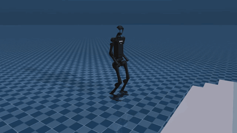
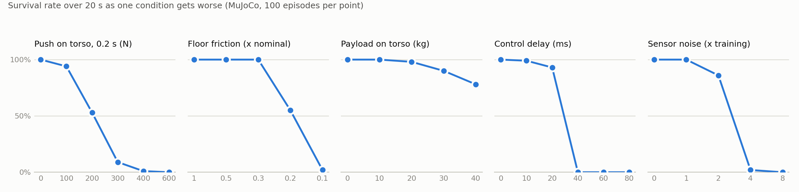
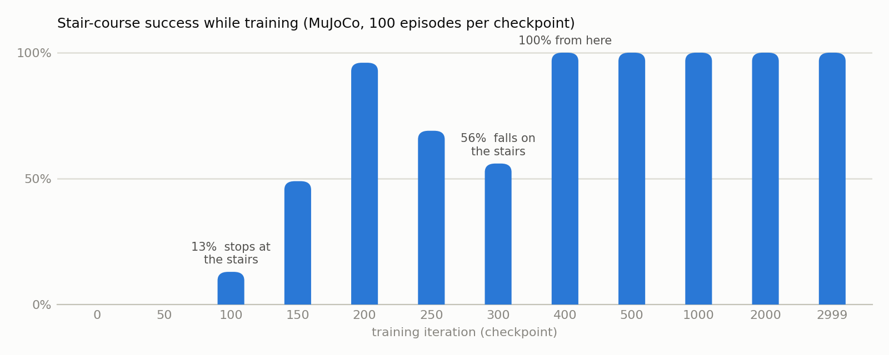
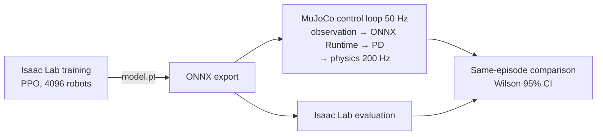

# HumanoidLocomotion

[](LICENSE)
[](#environment)


## 🌐 [한국어 → README.md](README.md)

Unitree H1 walking policies (flat ground and stairs) trained with PPO in Isaac Lab, exported to ONNX,
and checked for the same performance in an ONNX Runtime control loop on a physics engine not used for training (MuJoCo).
The biggest weakness, control latency, was fixed by retraining with latency randomization: the policy now handles 40 ms.

| 300 iterations: climbs the stairs, then falls | 3000 iterations: clears the stairs |
|---|---|
|  |  |

**Videos (MuJoCo, 10 s, 0.65 m/s):** [300 iterations](docs/media/stairs_it300.mp4) · [3000 iterations](docs/media/stairs_it2999.mp4) · iterations 0/50/100 and the flat policy in [docs/media](docs/media)

---

## Quick start

Run the trained policies in a MuJoCo window. No GPU or Isaac Sim needed.

```powershell
python -m pip install mujoco==3.17.0 onnxruntime==1.23.2

# fetch only the H1 model from MuJoCo Menagerie
git clone --depth 1 --filter=blob:none --sparse https://github.com/google-deepmind/mujoco_menagerie.git ..\mujoco_menagerie
git -C ..\mujoco_menagerie sparse-checkout set unitree_h1
$env:MENAGERIE = "..\mujoco_menagerie"

python sim2sim.py policies\h1_stairs.onnx --course             # stair course
python sim2sim.py policies\h1_flat.onnx --course               # flat policy has no terrain input and falls on the stairs
python sim2sim.py policies\h1_flat.onnx --vx 0.8 --wz 0.5      # flat ground, velocity command (m/s, rad/s)
```

The robot walks 1.5 m of flat ground → 3 steps → the upper platform, and restarts when it reaches the end or falls.

| Policy | Input | Use |
|------|------|------|
| `policies/h1_flat.onnx` | 69 | flat walking |
| `policies/h1_stairs.onnx` | 256 (69 + height map 187) | stairs and rough terrain |
| `policies/h1_stairs_delay.onnx` | 256 | stairs, trained with 0–40 ms control latency randomization |

ONNX input `obs`, output `actions` (batch 1). The flat/stairs policy is detected from the input size.

---

## Overview

| Item | Details |
|------|------|
| Robot | Unitree H1 (19 joints, 51.4 kg) |
| Task | Velocity-command (forward, turn) tracking: flat / 3 steps (15 cm high) + platform |
| Training | Isaac Lab PPO (rsl_rl), 4096 robots in parallel on GPU |
| Policy | MLP: body state 69 (+ height map 187) → 19 joint position targets |
| Deployment | ONNX Runtime (CPU) 50 Hz control loop + joint PD |
| Validation engine | MuJoCo 3.17 + Menagerie `unitree_h1` (built separately from the Isaac model) |
| Evaluation | Same 100 episodes (commands, initial state) on both engines, Wilson 95% CI |

---

## Results

### Engine comparison (same ONNX, same 100 episodes)

| Scenario | Isaac Lab (training engine) | MuJoCo (validation engine) |
|---|---|---|
| Flat, 20 s walk, falls | 0/100 | **0/100** (95% CI 0–3.7%) |
| 3 steps + platform, success | 100/100 | **100/100** (95% CI 96.3–100%) |
| Stairs, flat policy without height map | — | 0/100 |

- The stairs policy's height-map input (187 rays) was reimplemented in MuJoCo and compared with the values Isaac fed the policy at the same pose: **difference 0.0000 m**
- Flat velocity tracking error: linear 0.063 vs 0.066 m/s (same); only turning is about 50% worse in MuJoCo, 0.054 vs 0.081 rad/s (joint damping ruled out; foot contact and friction are the next suspects)

### Control latency (stair course, MuJoCo, successes out of 100)

| Latency | 0 ms | 10 ms | 20 ms | 30 ms | 40 ms | 60 ms |
|---|---|---|---|---|---|---|
| Original stairs policy | 100 | 100 | 100 | 93 | 73 | 0 |
| **Retrained with latency randomization** | 100 | 100 | 100 | **100** | **100** | **83** |

- Retraining: during training, joint targets reach the motors 0–40 ms late, randomized per episode ([h1_delay_cfg.py](h1_delay_cfg.py)). Isaac stairs stays 100/100
- Cost: arrival time at 0 ms latency 6.70 → 6.95 s
- The PD implementation also changed from implicit to explicit, so the effect of latency training alone is not isolated

### Flat policy robustness limits (MuJoCo, one condition at a time, 100 episodes per level)

<picture>
  <source media="(prefers-color-scheme: dark)" srcset="docs/images/robustness_dark.png">
  
</picture>

| Condition | 20 s survival |
|---|---|
| Push (torso, 0.2 s) | 100 N 94% → 200 N 53% → 300 N 9% |
| Ground friction | 100% down to ×0.3 → ×0.2 55% → ×0.1 2% |
| Torso payload | +20 kg 98% → +40 kg 78% |
| Control latency | 10 ms 99% → 20 ms 93% → **40 ms 0%** |
| Sensor noise (vs training level) | ×1 100% → ×2 86% → ×4 2% |

Torque saturation stays at or below 1.2% in every condition → failures come from the policy's response, not motor strength. Training had all randomization except sensor noise (push, friction, mass, latency) turned off.

### Stair success by training checkpoint (MuJoCo, 100 episodes each)

<picture>
  <source media="(prefers-color-scheme: dark)" srcset="docs/images/stairs_by_checkpoint_dark.png">
  
</picture>

At 100 iterations the robot stops in front of the stairs; at 250–300, while the training terrain difficulty rises, it falls on the stairs; from 400 on it is 100%.

---

## Architecture



The MuJoCo control loop has the same structure as a real robot's (feed sensor values instead of simulator state). What was matched between the engines:

| Item | Details | Check |
|---|---|---|
| Joint order | Isaac is breadth-first, MuJoCo is legs→torso→arms → mapped by name | [check_isaac_cfg.py](check_isaac_cfg.py) against the live env |
| Observation | Base velocity at the COM in the body frame, turn tracking about world z | same script |
| Control | PD gains, default pose, action scale, dt/decimation | same script |
| Height map | 17×11 vertical rays from 20 m above the torso, yaw-aligned only | 0.0000 difference vs Isaac's recorded values |
| ONNX | checkpoint → ONNX converter [export_ckpt.py](export_ckpt.py) | 0.0 output difference vs the Isaac Lab exporter |

Model differences between the engines were left as they are: the MuJoCo model has tighter torque limits (ankle 40 Nm, arms 18–40 Nm) than training (100–300 Nm), and different foot collision shapes (capsules) and joint damping.

---

## Training

| | Flat | Stairs | Stairs + latency |
|---|---|---|---|
| Task | `Isaac-Velocity-Flat-H1-v0` | `Isaac-Velocity-Rough-H1-v0` | stairs + 0–40 ms motor latency |
| Input | 69 | 256 (+ height map 187) | 256 |
| Actor MLP | 128-128-128 | 512-256-128 | 512-256-128 |
| Scale | 4096 robots × 24 steps × 1000 iter | 4096 robots × 24 steps × 3000 iter | same |
| Time (RTX 4070 SUPER) | 17 min | 1 h 2 min | 1 h 20 min |

- Input 69 = base linear velocity 3 + angular velocity 3 + gravity direction 3 + velocity command 3 + joint positions 19 + joint velocities 19 + previous action 19
- Output 19 = joint position targets (default pose + 0.5 × output)
- Rewards are the Isaac Lab H1 defaults. The stairs task uses a terrain curriculum (stairs, slopes, bumps)

---

## Reproducing training and evaluation

[setup.bat](setup.bat) installs the venv, PyTorch 2.7.0+cu128, Isaac Sim 4.5.0, Isaac Lab v2.1.1, MuJoCo, and ONNX Runtime.

```bat
set VENV=D:\venv-lab
set LAB=D:\IsaacLab
setup.bat
```

Run from this folder (Isaac Lab creates `logs\` in the working directory).

```powershell
$env:OMNI_KIT_ACCEPT_EULA = "YES"
$env:LAB = "D:\IsaacLab"   # same path as setup.bat
$RL = "$env:LAB\scripts\reinforcement_learning\rsl_rl"

# training → logs\rsl_rl\<experiment>\<run>
python $RL\train.py --task Isaac-Velocity-Flat-H1-v0 --headless
python $RL\train.py --task Isaac-Velocity-Rough-H1-v0 --headless
python train_delay.py --headless
python export_ckpt.py logs\rsl_rl\h1_rough\<run>\model_2999.pt policies\h1_stairs.onnx

# flat / stairs: Isaac vs MuJoCo
python -u eval_isaac.py policies\h1_flat.onnx --out results\isaac.json
python sim2sim.py policies\h1_flat.onnx --headless --out results\mujoco.json
python eval_stats.py results\isaac.json results\mujoco.json
python -u stairs_isaac.py policies\h1_stairs.onnx --out results\isaac_stairs.json
python sim2sim.py policies\h1_stairs.onnx --stairs --out results\mujoco_stairs.json
python sim2sim.py policies\h1_stairs.onnx --check-scan results\isaac_stairs.json   # height-map comparison

# robustness, latency sweep, success per checkpoint, plots
python robustness.py policies\h1_flat.onnx
python stairs_delay.py policies\h1_stairs_delay.onnx --out results\mujoco_stairs_delay_dr.json
python stairs_curve.py logs\rsl_rl\h1_rough\<run>
python plots.py
```

- Config check: `python -u check_isaac_cfg.py` → last line `CHECK OK` (exit code can be 0 even on failure)
- Isaac-side scripts never import mujoco: after Isaac Sim (Kit) starts, loading the mujoco/onnxruntime DLLs fails (`WinError 1114`). onnxruntime is imported before Kit starts

---

## Project structure

```
├── sim2sim.py           # MuJoCo control loop: observation → ONNX Runtime → PD; evaluation, recording, height-map check
├── h1_isaac.py          # training constants (joint order, default pose, PD, dt, height-map grid, eval commands)
├── course.py            # stair course (shared by MuJoCo boxes / Isaac terrain), success check
├── eval_isaac.py        # Isaac Lab flat evaluation
├── stairs_isaac.py      # Isaac Lab stairs evaluation, height-map logging
├── check_isaac_cfg.py   # checks h1_isaac.py against the live Isaac Lab env
├── h1_delay_cfg.py      # latency-randomized training config
├── train_delay.py       # runs latency training
├── robustness.py        # robustness sweep (MuJoCo)
├── stairs_delay.py      # stairs latency sweep (MuJoCo)
├── stairs_curve.py      # stair success per checkpoint
├── export_ckpt.py       # checkpoint (.pt) → ONNX (no Isaac needed)
├── eval_stats.py        # Wilson CI, mean CI, McNemar
├── plots.py             # README plots (light/dark)
├── setup.bat
├── policies/            # trained ONNX policies
├── results/             # evaluation JSON
└── docs/                # plots, videos
```

---

## Environment

| Item | Version / value |
|------|-----------|
| OS | Windows 11 Pro 23H2 |
| GPU | NVIDIA GeForce RTX 4070 SUPER 12GB (stairs training uses 9.4 GB VRAM) |
| NVIDIA driver | 591.86 (595.xx and later crash Isaac Sim 4.5 at startup) |
| Python | 3.10 |
| Training | Isaac Sim 4.5.0, Isaac Lab v2.1.1, rsl-rl-lib 2.3.3, PyTorch 2.7.0+cu128 |
| Validation | MuJoCo 3.17.0, ONNX Runtime 1.23.2 (CPU) |
| Control rate | physics 200 Hz, policy 50 Hz |

---

## Limitations

- Not tested on a real robot (validated between two simulators)
- The base linear velocity input can't be measured directly on a real robot (needs a state estimator). The simulated height map is ideal: no occlusion or noise

---

## License

MIT © [kmikesierra01](https://github.com/kmikesierra01)

The MuJoCo H1 model is not included: [MuJoCo Menagerie](https://github.com/google-deepmind/mujoco_menagerie) `unitree_h1` (BSD-3-Clause, Unitree Robotics).
